<div align="center">


# MatDock

**A Docker manager for your servers – in the browser.**

Environments over SSH or the local socket, stacks, containers, volumes, live logs, a web
terminal and real backups. One container, no cloud, no agents on the hosts.

</div>

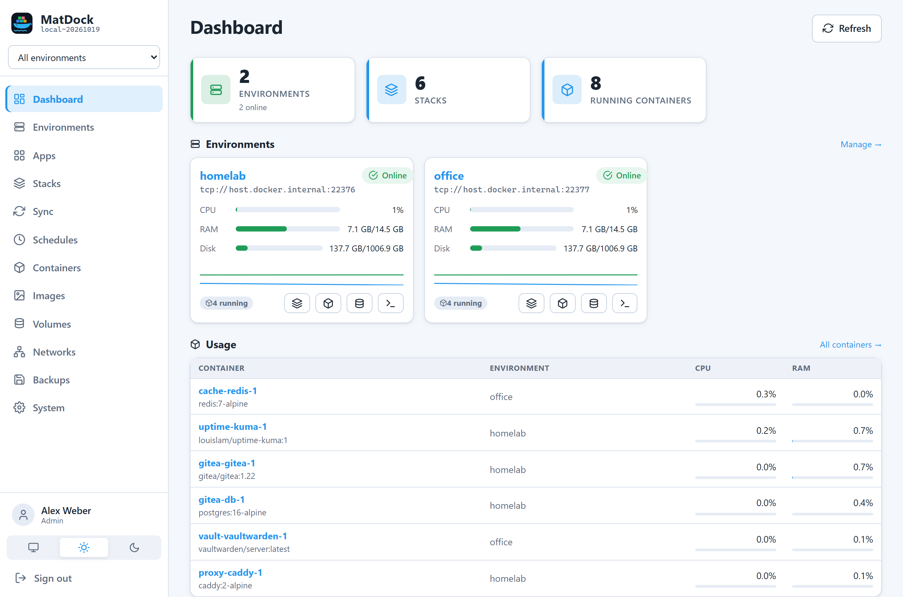

---

## What this is about

Portainer and the like are great – but running many small servers means one agent per host,
another UI per box, and backups that are somebody else's problem. MatDock connects to your
hosts over plain **SSH** (or the **local Docker socket**) – nothing to install on the target –
and puts a single dashboard on top of all of them: stacks, containers, volumes, images and
live logs across every environment, with a global switcher to look at one host or **all at
once**. On top of that it does what most managers leave out: **volume migration between hosts**
and **scheduled, restorable backups** – single volumes or whole stacks.

## At a glance

**Environments**
- Connect over **SSH** (password or key) or the **local Docker socket** – no agent on the host
- **Host stats** per environment: CPU load, RAM and disk, running containers, Docker version
- A **global environment selector** in the sidebar – one host or **"All environments"**, every
  page follows it
- Connection test with a clear result; secrets stored **encrypted**; the **SSH host key** is saved at the first
  connection and a server that shows another one is refused (forget it on the environment after a reinstall)

**Dashboard**
- Environment tiles with **live CPU / RAM / disk** usage (the dashboard, environments, containers and stack pages
  refresh themselves every 20–30 s while open), **top containers** by load, a feed of
  recent **container events** (created / started / stopped) and the **backup status**

**Stacks & containers**
- **Managed and discovered** Compose stacks side by side – list or tiles, **expandable to the
  container cards** with per-service actions
- Add a stack from the **Compose editor**, from **Git**, or from an **App template**
- Deploy / redeploy / stop, aggregated **resources** per stack
- Container list with **short status** (hover for detail), **ports as clickable tags**, combined
  **CPU/RAM**, and actions: **open, shell, logs, volumes, start/stop/restart**
- A **file browser inside a running container** (the same as for volumes: browse, edit, upload, download, create,
  rename, duplicate, delete; it runs `docker exec`, so the container needs a shell)

**Images**
- List across environments with size, age and whether a container uses it; a **detail page** with tags, digest,
  platform, entrypoint, ports, labels and the **layers** (`docker image history`); prune dangling or **all unused** images

**Networks**
- List, details with the attached containers, prune; a **network map** per environment: the networks and the
  containers on them, so you see which services can reach each other

**Volumes**
- List across environments, **migrate a volume from one host to another** (tar over SSH)
- **File explorer** in the volume: browse, **edit text files**, image **preview**, **upload**,
  **download**, create folder/file, rename, duplicate, delete
- Create volumes, backup and restore

**Backups**
- **Scheduled jobs** (cron) with retention, plus a full **history**
- **Targets**: the local data volume or a **NAS via SMB** – browse the archives actually present
  at a target and **restore even backups written by another/older MatDock**
- **Full stack bundles**: all volumes **+ the compose definition + image references** in one
  backup, restored as a running stack (images are pulled again on restore)

**Operations**
- **Live log viewer** (streaming `docker logs -f`): pause, follow, **live filter**, **search**, timestamps – for one
  container or a **whole stack** at once
- **Web terminal** (xterm.js) – a shell on the host or straight into a container
- **Apps**: reusable Compose blueprints with icons, installed as a stack in one click
- Users & roles, notifications (**SMTP + webhook**), Git credentials – all under **System**
- An **activity log** (System → Activity): every action of a user and every changing call of the API, with user,
  target, environment and result, searchable, kept for 90 days

**Schedules and alerts**
- Cron schedules for prune (volumes, images, networks), status reports, health alerts, volume and stack backups and Git sync
- **Image updates**: the schedule *Update stacks* checks the registries for newer images of the tags in use and notifies,
  or pulls and redeploys (optionally after a stack backup); the Stacks list marks stacks with updates
- **Alerts**: event schedules for *container died* (an error exit or out of memory, not a stop), *container unhealthy*,
  environment offline and failed deploys, backups and syncs – with *Send a notification* the event itself is the message
- Two roles: **User** sees everything and starts/stops/restarts containers and reads their logs; **Admin** does the rest
  (environments, stacks, volumes, files, backups, schedules, terminal, settings). The sign-in is locked for 15 minutes after
  5 wrong passwords for one account (or 20 from one address)
- **Light and dark**, works well on **mobile**, no cloud and no third-party services

## Screenshots

### Stacks – expandable to the containers, with aggregated resources

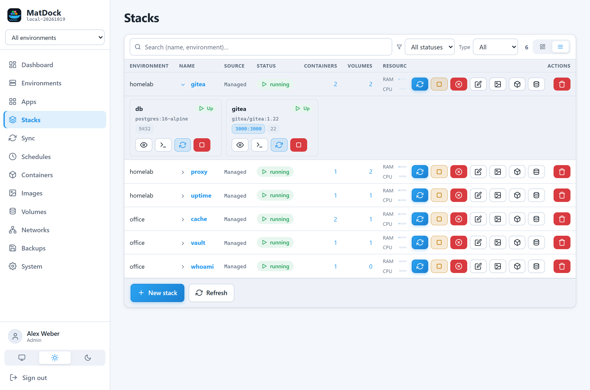

Managed and discovered Compose projects in one list. A row expands to show its containers as
cards – each with status, ports and start/stop/restart/logs/shell – and the row itself sums up
the stack's CPU and RAM.

### Containers – status, ports and resources at a glance

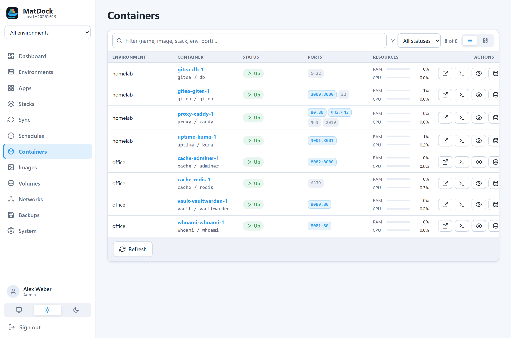

Short status with the full text on hover, published ports as tags that open the app in a new
tab, and CPU + RAM as one compact column. Open, shell, logs, volumes and lifecycle actions per
row.

### Volumes: migration, backups and a file explorer

| File explorer | Volumes |
|---|---|
| 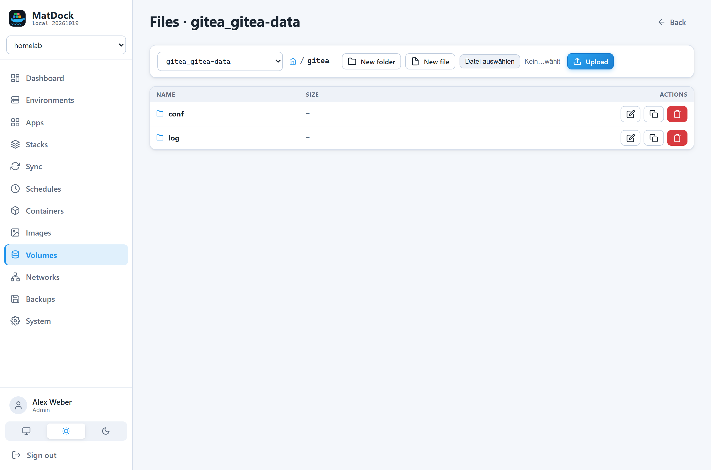 | 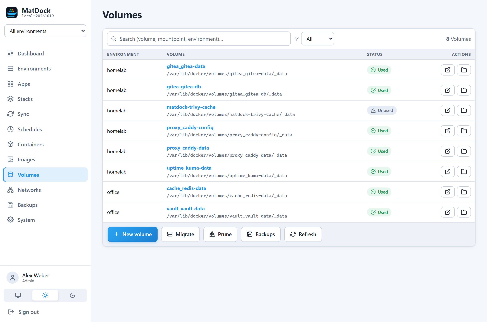 |

Browse a volume like a folder – edit, preview, upload and download – switch volumes from the
dropdown, or migrate a whole volume to another host.

### Backups you can actually restore

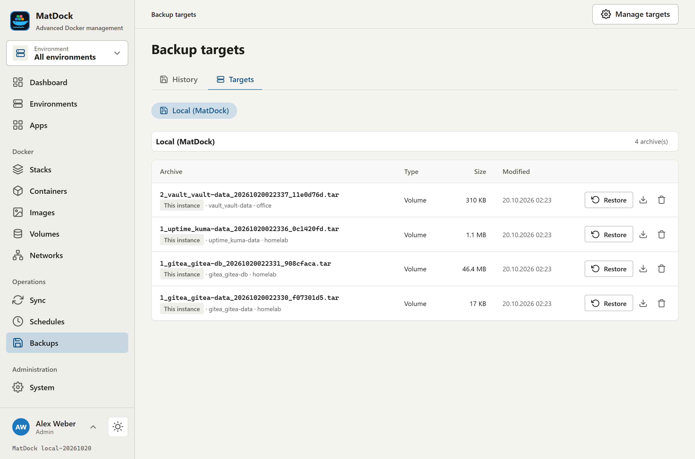

Every archive present at a target – including ones written by an older or a different MatDock
instance to the same NAS – ready to restore. Whole stacks are backed up as a bundle (volumes +
compose + image references) and come back as a running stack.

### Live logs

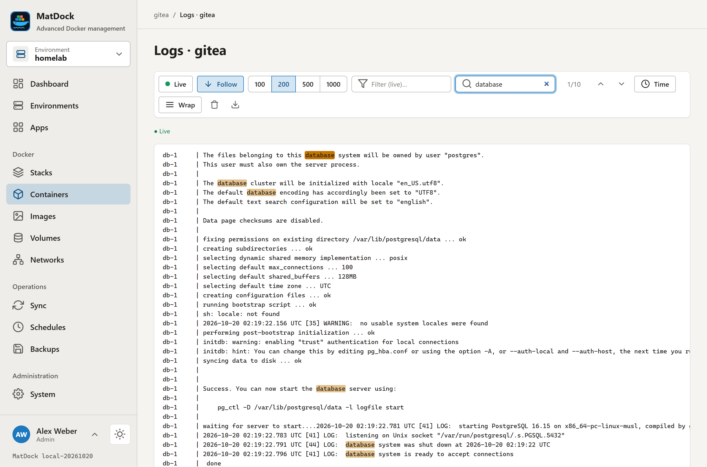

`docker logs -f` in the browser: follow, pause, filter to matching lines, and search with
highlighting and next/previous.

### Apps, environments and system

| Apps | Environments | System |
|---|---|---|
| 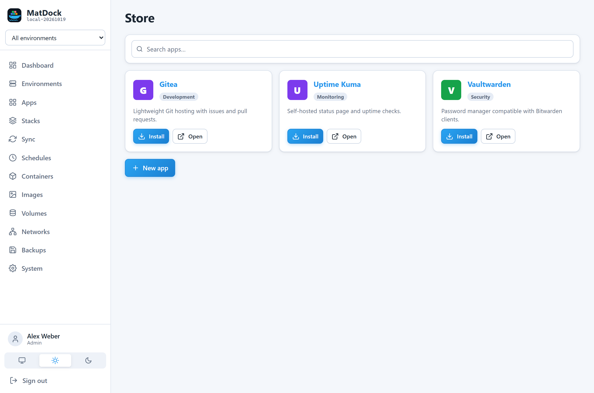 | 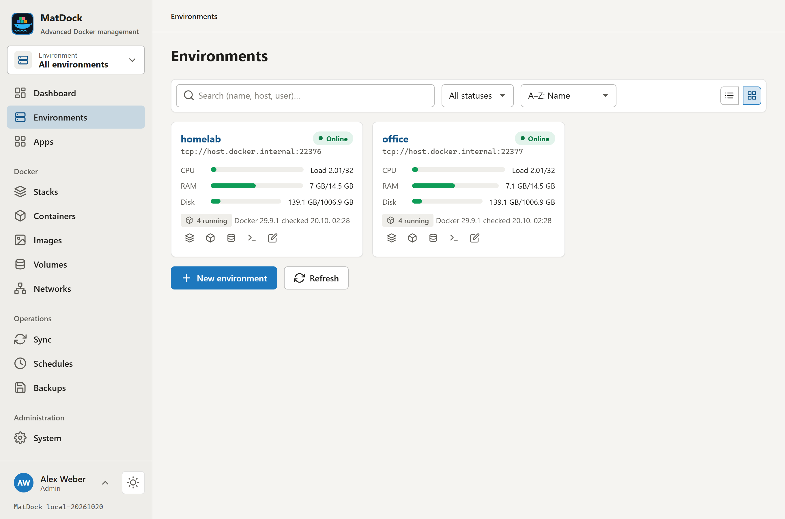 | 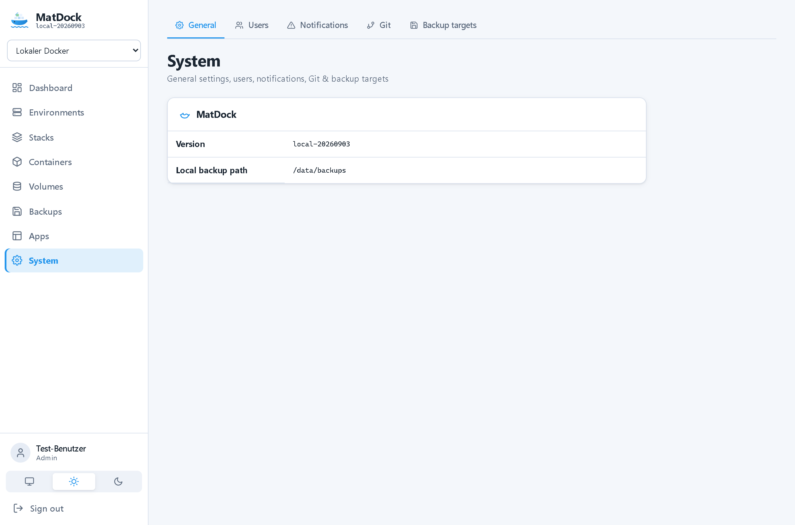 |

### Dark theme and narrow screens

| Dark | Phone | Menu |
|---|---|---|
| 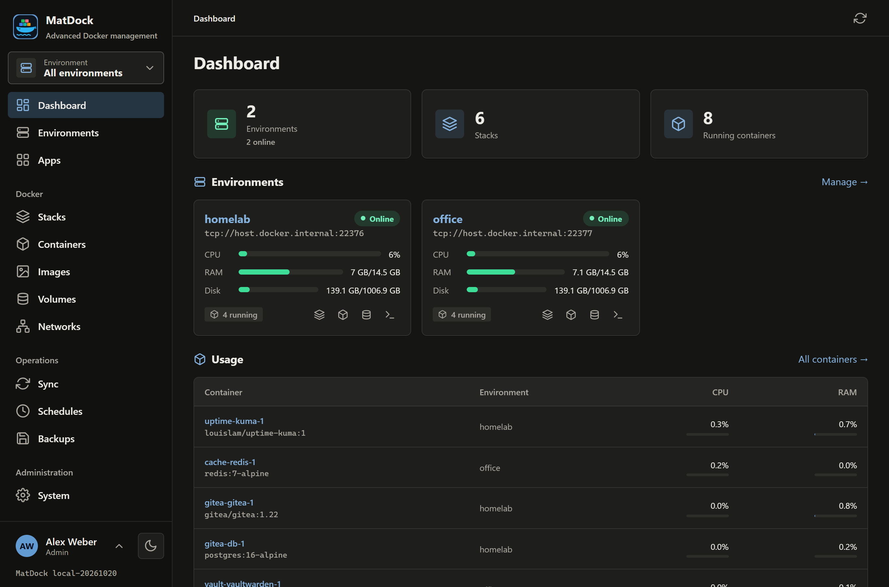 | 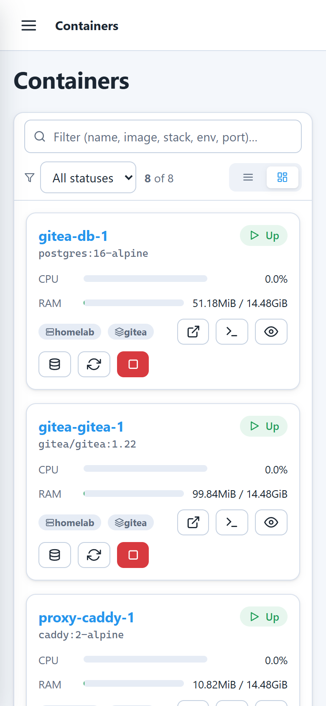 | 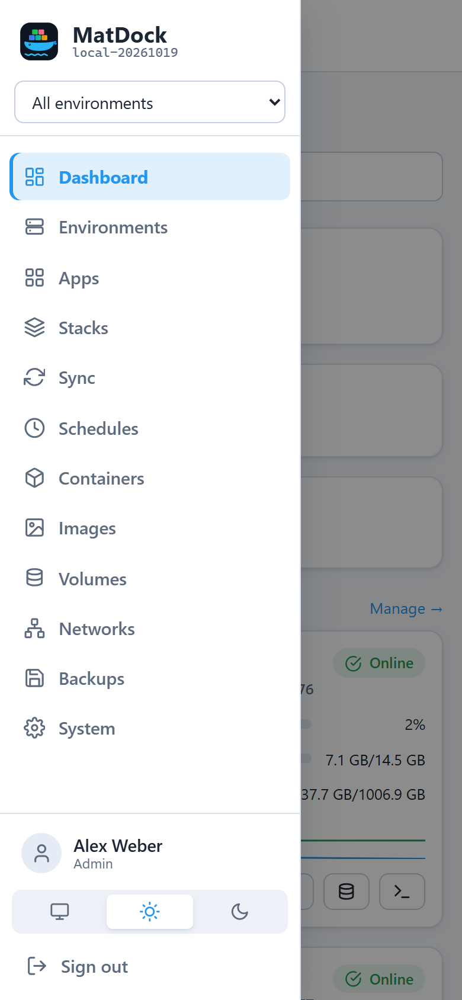 |

## Quick start

Ready-made images are published to the GitHub Container Registry:

| Tag | Built from | Use it for |
|---|---|---|
| `ghcr.io/real-ttx/matdock:release` (same image: `:latest`) | `main` | releases |
| `ghcr.io/real-ttx/matdock:<version>`, e.g. `:0.1.42-20261010` | `main` | pinning one release |
| `ghcr.io/real-ttx/matdock:nightly` | `dev` | the newest features |

`latest` is pushed together with `release` by every release build (older releases only carry `release` and
their version tag).

### 1. Just run it

```yaml
services:
  matdock:
    image: ghcr.io/real-ttx/matdock:release
    container_name: matdock
    restart: unless-stopped
    ports:
      - "4455:4455"
    environment:
      # Create the initial administrator on the first start (without Seed the setup wizard asks for one).
      # Username/Password only apply together with Seed=true – change the password before the first start.
      MatDock__Admin__Seed: "true"
      MatDock__Admin__Username: admin
      MatDock__Admin__Password: admin
    volumes:
      - matdock-data:/data
      # Optional: manage THIS host's Docker directly (a "local" environment)
      - /var/run/docker.sock:/var/run/docker.sock

volumes:
  matdock-data:
```

```bash
docker compose up -d
```

Open **http://localhost:4455** and sign in with **`admin` / `admin`** (you are asked to set a new password).
Without `MatDock__Admin__Seed` the first visit opens a setup wizard that creates the administrator. The `matdock-data`
volume keeps the database, the configuration, the backups and the session keys, so an update is
just `docker compose pull && docker compose up -d`.

Without Compose:

```bash
docker run -d --name matdock -p 4455:4455 \
  -v matdock-data:/data -v /var/run/docker.sock:/var/run/docker.sock \
  ghcr.io/real-ttx/matdock:release
```

### 2. Add your hosts

MatDock reaches your servers over SSH – nothing to install there. In the UI:
*Environments → New environment*, enter host, user and a password or private key, run the
**connection test**, save. The sidebar switcher then flips every page between a single host and
**all of them at once**.

The socket mount above is only needed if you also want to manage the machine MatDock runs on as
a **local** environment; remove it for an SSH-only setup.

### 3. As a Windows app

Every build also produces a **self-contained Windows executable** (`win-x64`, no .NET install
needed) as a CI artifact – handy for running MatDock straight on a workstation.

### 4. From source

```bash
docker compose up -d --build                              # release build
docker compose -f docker-compose.dev.yml up -d --build    # dev stack + SQLite web viewer
```

### Settings that matter

| Variable | Default | Meaning |
|---|---|---|
| `MatDock__Admin__Seed` | `false` | `true` = create the initial administrator from the two settings below on an empty database (headless installs); `false` = the setup wizard asks on the first visit |
| `MatDock__Admin__Username` / `__Password` | `admin` / `admin` | Initial administrator – **only with `MatDock__Admin__Seed=true`**, first start only; the password must be changed on the first login |
| `MatDock__Api__Key` | – | Enables the REST API (see [API](#api-for-mattiverse)); without a key the API answers `503` |
| `MatDock__Environments__EnsureLocal` | `false` | `true` = create a *Local* environment `local` at start (if none exists and the Docker socket answers) |
| `MatDock__DataPath` | `/data` | Data directory (SQLite, config, keys, backups, local stack files) |
| `ASPNETCORE_ENVIRONMENT` | `Production` | Standard ASP.NET Core environment |
| `MAT_API_KEY` | – | The key of the platform API (`/api/state`, `/api/configure`, `/api/actions`, see [Platform API](#platform-api-and-sign-in-through-matidentity)); Mattiverse sets it. Unset = the engine key `MatDock__Api__Key` is the key there too; neither = only a token of MatIdentity |
| `MATIDENTITY_AUTHORITY` | – | Address of MatIdentity (`https://id.example.com`). Set = sign-in through MatIdentity; unset = only the local sign-in, as before |
| `MATIDENTITY_CLIENT_ID` | `matdock` | The client of MatDock in MatIdentity (also the audience of the tokens accepted on `/api`) |
| `MATIDENTITY_CLIENT_SECRET` | – | Its secret |
| `MATIDENTITY_INTERNAL_URL` | – | Where MatDock reaches MatIdentity from inside Docker (`http://matidentity:2300`); the browser keeps using `MATIDENTITY_AUTHORITY` |

### The `/data` volume

```
/data
├─ matdock.db            SQLite database
├─ config/               JSON configuration
├─ dataprotection-keys/  session & secret keys (survive restarts)
├─ backups/              local backup archives
└─ stacks/<name>/        compose + .env of the stacks deployed to the local environment
```

Stacks on SSH hosts keep their files on the host in `~/.matdock/stacks/<name>`.

## API (for Mattiverse)

MatDock is one of the engines of [Mattiverse](https://github.com/Real-TTX/Mattiverse): Mattiverse installs apps as
MatDock stacks and uses MatDock's backups and schedules, so everything stays visible and editable here. The contract is
`docs/ENGINES.md` in the Mattiverse repository.

- **Key:** set `MatDock__Api__Key`; every call sends it as `X-Api-Key` (compared in constant time). No key configured =
  `503`, wrong or missing key = `401`. The session cookie plays no role. Errors are `{"error": "…"}`.
- **Environment:** calls work on the *Local* environment (the mounted Docker socket) unless `?environment=<id or name>`
  says otherwise. `PUT /api/v1/environments/local` or `MatDock__Environments__EnsureLocal=true` creates it.
- **Long actions** answer `202 {"operationId": "…"}`; poll `GET /api/v1/operations/{id}?offset=<chars read>` for the
  output (streamed while it runs), `status` (`running|succeeded|failed`), `error` and `result`. Operations live in
  memory for an hour after they finish.
- **Managed by:** stacks and schedules created through the API carry `managedBy` (e.g. `mattiverse`). The Stacks and
  Schedules pages show a **"Managed by Mattiverse"** badge (tooltip: *Created by Mattiverse. Manual changes may be
  overwritten.*); editing such an object in MatDock keeps the value.

| Method and path | |
|---|---|
| `GET /api/v1/status` | `ok`, `app`, `version`, `apiVersion` (1), `environments` |
| `PUT /api/v1/environments/local` | ensure the Local environment `local` → `{id, name, created}`; `409` without a Docker socket |
| `GET /api/v1/stacks?managedBy=` | managed and discovered stacks with `state` (`running/stopped/partial/unhealthy/missing`) and containers |
| `GET /api/v1/stacks/{name}` | the same plus `composeYaml` and `envContent` |
| `PUT /api/v1/stacks/{name}` | upsert `{composeYaml, envContent, managedBy, deploy, pull}`; `200 {stack}` or with `deploy` `202 {stack, operationId}` |
| `POST /api/v1/stacks/{name}/actions/{action}` | `start`, `stop`, `restart`, `pull`, `redeploy`, `update` (`{backupFirst}`; result `{changed}`) → `202` |
| `DELETE /api/v1/stacks/{name}?volumes=false` | `compose down` (`--volumes`), then the stack is removed from MatDock → `202` |
| `GET /api/v1/stacks/{name}/logs?service=&tail=300` | `{text}` |
| `POST /api/v1/stacks/{name}/backups` | bundle backup `{stopContainers, note, targetId}` → `202`, result `{backupId}` |
| `GET /api/v1/backups?stack=` | the stack bundles, newest first |
| `POST /api/v1/backups/{id}/restore` | `{backupCurrentFirst}`; re-creates the stack when it is gone → `202` |
| `DELETE /api/v1/backups/{id}` | `204` |
| `GET /api/v1/backups/{id}/download` | the bundle (manifest + volume archives) as one `.tar` |
| `GET /api/v1/backup-schedules`, `PUT`/`DELETE /api/v1/backup-schedules/{name}` | bundle schedules `{stack, managedBy, frequency, time, weekday, retention, stopContainers, enabled}`; `time` is UTC |

A stack bundle holds all volumes of the stack, its compose file, its `.env` and the image references; bundle schedules
appear on the Schedules page (action *Backup stacks*) and keep the newest scheduled bundles per stack.

## Platform API and sign-in through MatIdentity

Besides its engine API, MatDock speaks the platform contract of the Mat apps (MatDesign `docs/PLATFORM.md`, shared code
MatPlatform in `src/MatDock.Web/MatPlatform/`, a copy – never edit it here), so Mattiverse can show, watch and set it up
without knowing it beforehand. It lives next to `/api/v1` and never under it; `/api/v1` is unchanged.

| Endpoint | Access | |
|---|---|---|
| `GET /api` | anonymous, rate limited | the MatApiDefinition: pages, tiles, settings, actions, roles (German or English by `Accept-Language`), `ETag` |
| `GET /api/health` | anonymous, rate limited | `ok` / `degraded` (`200`) or `down` (`503`); the Docker `HEALTHCHECK` calls it |
| `GET /api/state`, `/api/state/{key}` | key or token | the values of the tiles |
| `GET`/`PUT /api/configure` | key or token | the few settings; a secret is only ever `{"isSet": bool}` |
| `POST /api/actions/{id}` | key or token | run an action → `{"ok", "message"}` (`409` when it cannot run now) |

- **Key:** `X-Api-Key` = `MAT_API_KEY`, or the engine key `MatDock__Api__Key` when `MAT_API_KEY` is not set (one key for a
  caller that only knows the engine key). `/api/v1` still takes only `MatDock__Api__Key`. Without a key `401`.
  With MatIdentity on, a bearer token of MatIdentity for the audience `matdock` works too.
- **Tiles:** environments (and the unreachable ones), stacks, containers running / stopped / unhealthy, images, the
  disk of the local Docker host (used of total), the last backup (status and time), the next scheduled backup, failed
  backups in the last 24 hours and the size of the stored backups. Docker is asked only on reachable environments,
  with a short timeout, and the answers are cached for 30 seconds.
- **Health:** `down` when the database cannot be read; `degraded` when an enabled environment is unreachable or there is
  no active administrator.
- **Settings:** the notification settings (the same as *Settings → Notifications*): notify on failures, e-mail (server,
  port, user, password, sender, recipients) and the webhook.
- **Actions:** open MatDock, Stacks, Backups; *Run all backups now* (every enabled backup schedule, started in the
  background, the result shows in the tiles); *Prune dangling images* on every reachable environment (asks first).
- **Roles:** `admin`, `user`.

**Sign-in through MatIdentity** (only with `MATIDENTITY_AUTHORITY`; without it nothing changes): the sign-in page goes
straight to MatIdentity (authorization code with PKCE). Redirect address `/signin-oidc`, signed-out address
`/signout-callback-oidc`. The local sign-in stays at `/Account/Login?local=1` (a way in when MatIdentity is down).
The person is matched by `sub`; the first sign-in creates the user (no password). An existing account whose user name
equals the person's `preferred_username` or e-mail is **not** linked by the name alone: the sign-in page asks to sign in
once with that account's password (`?local=1&link=1`, or cancel), then it is linked. Several matches, or a match linked to
another person, are refused. The claim `role` (`admin` / `user`) sets the role at every sign-in, never demoting the last
administrator; without it MatDock keeps managing roles itself. Signing out ends the session at MatIdentity too.

## How it is built

- **ASP.NET Core 10** (Razor Pages) with **EF Core** on SQLite
- Docker access without an agent: **SSH.NET** opens a channel to the host and runs the Docker
  CLI; a **local** environment talks to the mounted socket instead – both behind one interface
- Volume migration & backups stream a **tar over SSH** (no temp files on the host); backup
  targets are the local volume or **SMB** (SMBLibrary, no OS mount)
- The web terminal is **xterm.js** over a WebSocket ⇄ SSH PTY; live logs stream the same way
- The interface is **plain JavaScript** – no framework, no build step; secrets are encrypted
  with **DataProtection**

## Status

| Milestone | Content | Status |
|---|---|---|
| Foundation | Docker, CI, versioning, auth, roles, sessions, design system | ✅ |
| Environments | SSH + local socket, host stats, global selector | ✅ |
| Volumes | Listing, migration between hosts, file explorer | ✅ |
| Backups | Scheduled jobs, retention, history, SMB targets, restore | ✅ |
| Containers & stacks | Managed + discovered stacks, containers, live logs, terminal | ✅ |
| Backup v2 | Browse/restore archives at a target, full stack bundles | ✅ |
| Apps | Compose templates with icons, one-click install | ✅ |
| Next | Complex volumes (NFS/CIFS), Entra ID, anonymous share links | open |

## Branches & versioning

| Branch | Purpose | Version |
|---|---|---|
| `main` | Release | `<major>.<minor>.<build>-<yyyyMMdd>` |
| `dev` | Development | `nightly-<build>-<yyyyMMdd>` |
| local | – | `local-<yyyyMMdd>` |

`Major`/`Minor` live in [`Directory.Build.props`](Directory.Build.props); the build number comes
from the GitHub action. Images are published to the GitHub Container Registry, and a
self-contained Windows EXE is attached to every build.
